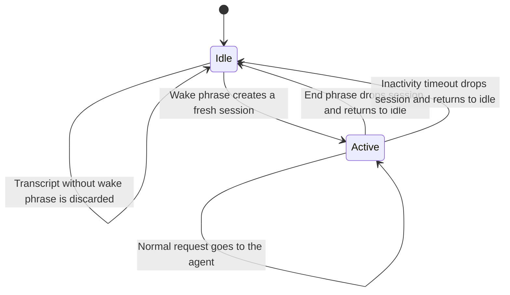
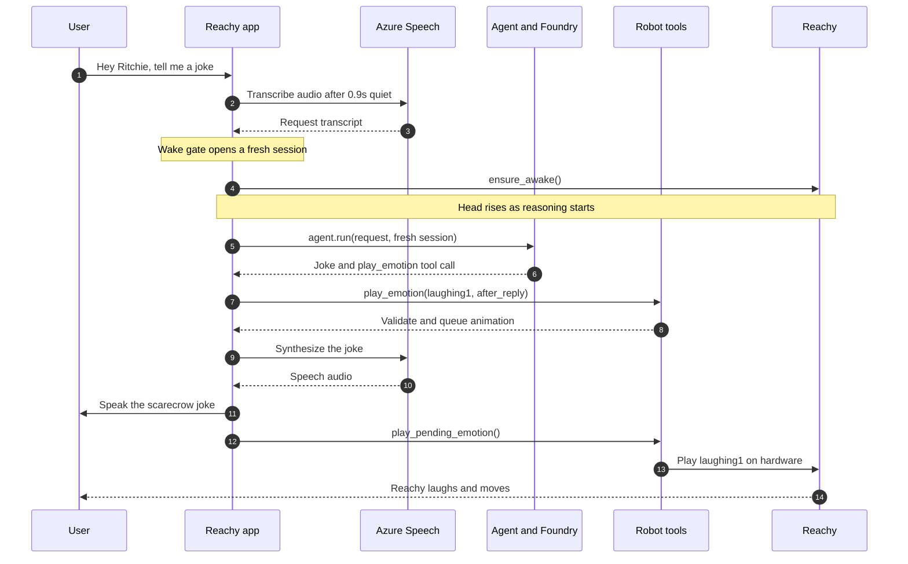
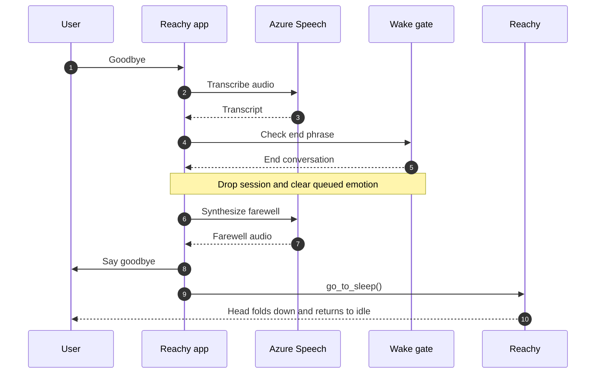

## TL;DR

- 🦾 [Reachy-Foundry](https://github.com/nampacx/Reachy-Foundry) connects a Reachy Mini Wireless to Microsoft Foundry and Azure Speech.
- 🎙️ A voice loop turns speech into an agent request, then turns the answer and tool calls into speech and movement.
- 🤖 This is physical AI through integration, not a story about training a model. Next up: connect the camera and make voice interactions feel faster.

## From a desk ornament to a voice agent

Before I got to the AI part, my girlfriend cursed me for the sounds Reachy makes when it starts and stops. I was restarting it often while developing, so she kept hearing them. Fair enough: the startup and shutdown soundtrack became part of my test loop.

When Reachy Mini arrived, I had the robot on my desk and a question: what would it take to make it more than a cute desk companion? I wanted to talk to it, give it a task, and have it answer with more than words. A nod, a head shake, a wiggle of the antennas, maybe even a little dance.

That became [Reachy-Foundry](https://github.com/nampacx/Reachy-Foundry), a project connecting the robot to Microsoft Foundry. It runs on a Reachy Mini Wireless, with Azure providing the speech services and the model behind the conversation. The robot is not just a character on a screen: its head and antennas can move in response to what the agent says.

This is the kind of project I mean when I say **physical AI**. The interesting part isn't a newly trained model. It's connecting perception, reasoning, and action so an AI system can respond in the physical world.

## Getting my code onto Reachy

One early challenge was deployment. The Reachy Mini Windows desktop app didn't have a way to upload an app from my local development setup. My good old friend, the coding agent, helped me work through a few approaches. After some trial and error, I ended up with a PowerShell script that deploys the app to Reachy over SSH.

The [deployment script](https://github.com/nampacx/Reachy-Foundry/blob/main/scripts/deploy-to-robot.ps1) installs the app into the robot's app environment and can restart the daemon as part of the deploy. That gave me a repeatable local edit, SSH deploy, test-on-the-robot loop. It also explains why Reachy's startup and shutdown sounds got so many repetitions. The [deployment notes](https://github.com/nampacx/Reachy-Foundry/blob/main/docs/deployment.md) cover the setup.

_Reachy telling a joke, with captions. The GIF is from the [Reachy-Foundry repository](https://github.com/nampacx/Reachy-Foundry), where you can also watch the full video with sound._

## A voice loop with a body at the end

The app and its audio loop run on Reachy Mini Wireless, whose Raspberry Pi Compute Module 4 uses ARM64. Audio capture and playback go through Reachy's media interface. A lightweight energy endpointer closes an utterance after about 0.9 seconds of silence, then the app sends the audio to Azure Speech for transcription over REST. The Speech SDK isn't used here: it has no ARM64 wheels for the robot, and it would compete with the Reachy daemon for the microphone and speaker.

The transcript goes to a conversation gate. While Reachy is idle, speech is still transcribed so the gate can check for a wake phrase; anything that doesn't wake it is dropped before it reaches the chat model. On a match, the app creates a fresh Agent Framework session and forwards the request to the agent. The robot's head rises while the model request is already in flight.

The agent uses a `FoundryChatClient` for the deployed model and registers the robot's `RobotTools` as callable tools. That gives the model actions such as `move_head`, `nod`, and `play_emotion`. The model returns a tool name and arguments; it does not drive the motors directly. The Python tool handler checks and clamps those arguments, serializes physical actions, and then calls the Reachy SDK. The app logs tool calls and their duration too.

## Putting a gate in front of the model

In my first attempts, I had no conversation gate. Every transcript went straight to the LLM, and Reachy tried to respond to anything I said nearby. That felt wrong for a robot that was meant to join a conversation only when I wanted it to.

The model was doing what I had asked it to do: answer the input it received. One time, while my girlfriend was complaining about the startup noise, Reachy apologized and said he was sorry for being so annoying. It was funny, but it also made the problem obvious: ordinary background speech should not automatically become another model turn.

I wanted a simple rhythm: say a start phrase, talk to Reachy, then say an end phrase to put it back in idle. The gate now keeps transcripts out of the model until it hears the wake phrase. Once the conversation is active, normal requests go to the Agent Framework. The end phrase drops that conversation's session, so the next wake starts with a clean history.

This gate acts on transcripts, not raw audio. While Reachy is idle, Azure Speech still transcribes what it hears so the app can check for the wake phrase; the rejected transcript is not sent to the reasoning model. Local wake and stop detection is still on my list to reduce that cloud round trip.

## The joke, step by step

A joke is a small interaction, but it exercises speech recognition, the wake gate, model reasoning, tool calling, speech synthesis, and a physical action. I split the active joke turn from the goodbye path to keep both diagrams readable. The Agent Framework dispatches the model's `play_emotion("laughing1", when="after_reply")` call to local `RobotTools`, which validates and queues the animation. After the synthesized joke has played, the app tells the robot to run it.

Reachy's spoken answer is: "Why did the scarecrow win an award? Because he was outstanding in his field."

### Then the goodbye

The goodbye takes a different route. The gate recognizes the end phrase, the app drops the conversation session and any queued emotion, Reachy speaks its farewell, and the app puts the robot back to sleep. It doesn't need another reasoning-model round trip just to stop the conversation.

Reachy's farewell is: "Goodbye! Say my name when you need me."

## A wake phrase is not the same as a private microphone

Reachy goes idle after a conversation and waits for a wake phrase such as "Hey Reachy." While idle, recognized text is dropped instead of being forwarded to the chat model. There is an important detail, though: the current implementation still sends audio to Azure Speech for transcription so it can check for that phrase. "Not sent to the reasoning model" does not mean "never leaves the device."

I want that distinction to be clear. It is an architectural choice, and it matters to anyone evaluating where audio goes. The [wake and goodbye notes](https://github.com/nampacx/Reachy-Foundry/blob/main/docs/wake-and-goodbye.md) describe the gate and its behavior in more detail.

## 🚀 What's next

The current project is a voice-and-motion experiment, not a general-purpose humanoid assistant. The model can use the tools exposed by the app, and application code validates tool arguments before they reach the robot. With that basic loop in place, I have three clear next steps.

### Connect the camera

The repository has camera and on-robot person-detection code, but they are not wired into the agent conversation yet. Reachy cannot answer questions about what it sees today. I want to connect that path so the agent can use visual context, while being deliberate about when images are captured and sent for reasoning.

### Keep start and stop commands local

Right now, the wake and goodbye phrases are checked after Azure Speech transcribes the audio. I'm looking for a local solution for those start and stop voice commands. Recognizing them on the robot should avoid a cloud round-trip just to begin or end a conversation, which could make the interaction feel quicker. I still need to test how reliably that works with Reachy's microphone and real room noise.

### Reduce the wait for a response

The reasoning model's response latency is another area I'd like to improve. I'll look at faster model options and the time from the first model response to the first spoken audio, while checking that tool use still works reliably. A faster answer is only useful if Reachy can still do the right thing with it.

These are next steps, not capabilities the project already has. The camera would give Reachy more context; local start and stop detection and a faster reasoning path would make the conversation feel more immediate.

## The physical part changes the question

Building this made me think less about whether a model can answer a prompt and more about what happens after it answers. A physical agent has to connect speech, state, model decisions, tools, and hardware in a way that is observable and bounded. That is a different engineering problem from putting a chat window in front of a model.

Reachy-Foundry is a small, deliberately playful place to explore that boundary. The joke is fun, but the useful idea underneath it is simple: cloud reasoning can meet a local body, as long as the application is explicit about what the model can do, what data leaves the device, and what is still only a plan.

The code and setup notes are in [nampacx/Reachy-Foundry](https://github.com/nampacx/Reachy-Foundry).
